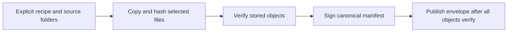
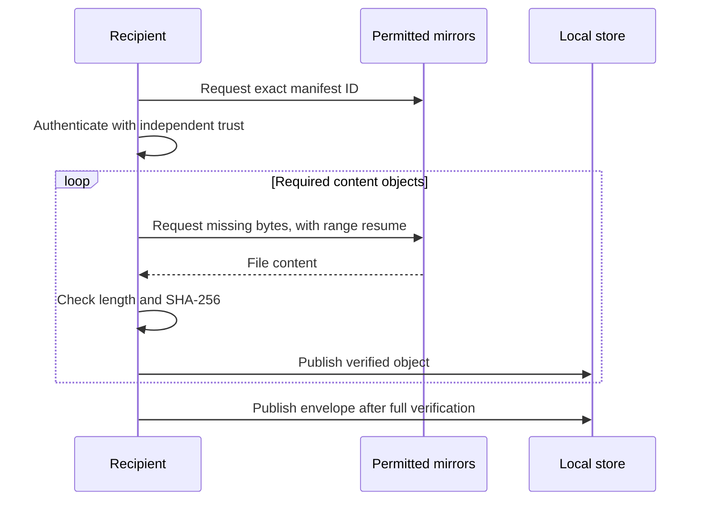

# How model preservation works

A model listing tells you what exists. A preservation copy keeps the actual files
needed for a selected use of that model. The core makes that copy portable: an
ordinary folder can move between disks, machines and HTTPS servers while its
signed identity stays the same.

Start with the [small working example](quickstart.md). The
[protocol](protocol.md) is the exact format reference; this guide explains why
its parts exist.

## Four different objects

| Object | Purpose | What it does not establish |
| --- | --- | --- |
| Recipe | Explicitly selects the local files, dependencies, notices and origin statements to capture. | It cannot discover a missing dependency for you. |
| Manifest | Records every selected file's path, byte length and SHA-256, plus member relationships and retained metadata. | A hash alone cannot tell you who supplied the list. |
| Signed envelope | Authenticates the exact manifest using independently enrolled owner keys. | An owner's signature is not upstream authorship, registry verification or model qualification. |
| Catalog | Provides named entries, exact manifest IDs and possible mirror locations, in its own signed envelope. | A catalog cannot replace the selected model's bytes or enroll its own signer. |

A **member** is one artifact in the selected set: for example weights, a required
vision projector, or notices from another repository. Each member has its own
namespace. The same `config.json` name in two members cannot overwrite the other.
Every member must be reachable from the root, and the dependency graph must have
no cycle or missing member.

Completeness refers to the declared selection. Pack does not infer that your
vision model needs a projector. It also does not package Python, inference
engines, GPU drivers or optional workflows unless those files were explicitly
selected. The manifest records runtime requirements separately.

## From source files to a portable copy



`pack` reads only the selected regular files. It checks optional expected hashes,
rejects unsafe paths and symlinks, and copies bytes into the preservation store.
It never makes the backup depend on links back to the original files.

The store has two public transport directories:

```text
manifests/<manifest-id>.json       signed envelope
objects/sha256/<file-sha256>       exact file content
```

Identical file content can share one stored object. The manifest keeps the member
and path mapping needed to restore the original layouts. The ID is the SHA-256
of the manifest's RFC 8785 canonical payload, not the URL, envelope serialization
or signing key. The same payload can carry different owner signatures. Receiving
it still requires the chosen trust profile to authorize the actual signatures.

A writer lock fences other writers to that store. Content is staged and checked;
the envelope is published last. Partial files alone are not completion. The
stored generation is checked again when you run `verify` or start `seed`.
Verification is an observation of actual bytes at that time, not a permanent
promise that the disk cannot change.

## How a recipient decides what to trust

The recipient needs an authentic verifier, the expected manifest ID, and a public
trust profile obtained through an independently authenticated reference.
Downloading a bundle and automatically trusting a key beside it would let its
supplier replace both.

The verifier checks the expected digest, the DSSE payload domain, the Ed25519
signatures and the required number of distinct non-revoked enrolled keys. It
then validates the canonical manifest and dependency/file layout. It checks file
lengths and hashes as bytes arrive. Replacing a manifest and its printed checksum
does not replace the recipient's independently enrolled authority.

Bundle and catalog keys can be separate. A catalog entry points to an exact
bundle; `fetch-catalog --bundle-trust` supplies its separate authority. A catalog
may add a mirror, but that mirror still has to supply the selected authentic
manifest and matching content. A private owner can use their own trust profile;
there is no required Foxlight signing key or online permission service.

The `as_of` field in a trust profile is an operator-supplied historical label.
Offline verification cannot know about a compromise announced after that profile
was retained. See [trust and recovery](trust-and-recovery.md).

## Downloading and restoring



Fetch uses only the supplied sources. It can mix local folders and HTTPS mirrors,
reuse verified objects, resume partial files and try another supplier. A corrupt
prefix is discarded before a clean retry. Source and byte limits bound retries.
It does not ask a hub for file lists, discover peers, follow redirects, send
credentials to mirrors, or start serving the downloaded files.

Restore copies the selected members into a fresh layout:

```text
restored-model/
  members/<member-id>/<selected-path>
  .preservation/envelope.json
```

It verifies the input and copied files and refuses an existing output directory.
This is a portable file layout, not an inference-runtime installation. The core
does not place a model, execute repository code, register a model card or install
an engine. [Library integration](python-api.md) describes that boundary.

## Sharing a copy

An ordinary static HTTPS server can serve the two transport directories. The
optional `seed` command provides bounded read-only HTTP(S) serving of explicitly
selected verified bundles. Public seed requires every member's recorded audience
to be public; the operator still checks actual redistribution rights and notices.

The signing key stays with its owner and is unnecessary for serving an existing
bundle. Another person can retain the bytes, use their own hosting and distribute
an independently signed catalog without obtaining a Foxlight account. Several
copies controlled by the same person remain one administrative domain.

Direct HTTPS protects transport but does not hide the client's IP or requested
files from the mirror. This release has no reviewed anonymity profile, P2P
protocol or demonstrated censorship resistance. [Operating the store](operations.md)
covers limits, failures and the currently known edge cases.
